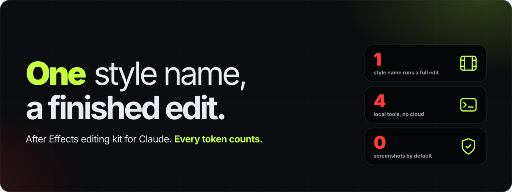
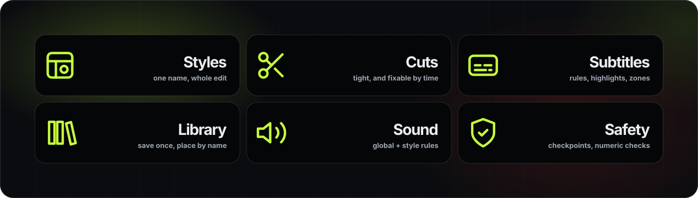
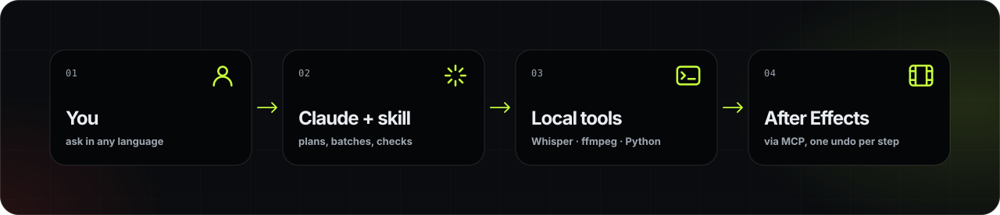

<p align="center">
  
</p>

<p align="center">
  <a href="https://github.com/keremgulluuu/ae-keremkit/actions/workflows/tests.yml"></a>
  <a href="LICENSE"></a>
  
  
</p>

KeremKit is a skill for Claude that turns it into a careful After Effects editor. It remembers how you like to work, runs a whole edit from a style name, cuts talking-head footage tight, builds subtitles from Whisper, and keeps a library of your designs so you never rebuild the same lower third twice.

It is built around one constraint: **every token counts**. Heavy work happens in small local tools, After Effects is driven through batched operations, and Claude checks its work with numbers instead of screenshots unless you ask for one.

## What it does

<p align="center"></p>

- **Edit styles.** Describe a style once — inputs, structure, fonts, palette, transitions, subtitle rules, sound effects — then say *"edit this in my Kerem style"*. Claude lists what it will use, asks if you want anything changed, and builds the edit.
- **Tight cutting you can tweak.** Pauses are found in the real audio and confirmed with Whisper's words; retakes, repeated phrases and filler sounds are removed, keeping the take you finished. Every cut stays editable: *"0:10–0:12 is cut too fast, add a second"* is one command, not a re-edit.
- **A transcript that's actually right.** Claude reads the transcript with the video's topic in mind and fixes mis-heard words ("Cloud" → "Claude"). Everything it changed comes back as a `time – old – new` list, and anything it isn't sure about is asked first.
- **Subtitles with real rules.** Words per line, lines per cue, sentence-aware splitting, what to do with a leftover word, highlighted keywords and numbers, different positions for different parts of the video. One text layer in AE reads a data file, so changing a rule never touches your timeline.
- **A design library.** Save a counter, a title, a transition; place it later by name in English or your own language, with its parameters (*"gold counter, 0 to 25,000, at 2 seconds"*).
- **Learns your presets.** Point it at your `.ffx` folder. Every preset becomes a card with its effects, keyframes and expressions, and the ones that need third-party plugins are marked. Ask "which presets use Deep Glow?" and get a real answer.
- **Copy a look.** Point at a screenshot, a web page, CSS, an SVG, a Lottie file or a project. Its palette, type, radii, glows and easing become tokens you confirm, then an After Effects theme.
- **Preferences that stick.** Nothing is assumed. Each choice is asked once, when it matters, and remembered.
- **Safety nets.** Numbered checkpoints before risky operations, standard layer naming, safe-area checks, a log of solved problems so the same error never costs time twice.

## How it works

<p align="center"></p>

The skill itself never changes after you install it. Everything you teach it lives in a `KeremKit` folder on your computer, so styles and preferences grow through conversation and survive reinstalls. Share that folder and someone else's Claude works the way yours does.

## Requirements

| | |
|---|---|
| **After Effects** | 2024 or newer, Windows or macOS. Enable *Preferences → Scripting & Expressions → Allow Scripts to Write Files and Access Network*. |
| **After Effects MCP server** | Any server that exposes `ae_do`, `ae_catalog` and `ae_context`. Built against [`@kumoproductions/mcp-aftereffects`](https://github.com/kumoproductions/mcp-aftereffects) (Node.js 24+). |
| **Claude** | Claude Code, or the Claude desktop app with access to your computer. |
| **Python** | 3.9 or newer. The tools use only the standard library. |
| **ffmpeg** | For cutting. `ffprobe` should be on the PATH too. |
| **Whisper** | Optional, for subtitles: [openai-whisper](https://github.com/openai/whisper), [faster-whisper](https://github.com/SYSTRAN/faster-whisper) or whisper.cpp. |

## Installation

### 1. Connect After Effects

Claude Code:

```bash
claude mcp add aftereffects -- npx -y @kumoproductions/mcp-aftereffects
```

For the Claude desktop app and other options, follow the [server's README](https://github.com/kumoproductions/mcp-aftereffects).

### 2. Install the skill

**Claude Code — from this repository (recommended):**

```bash
claude plugin marketplace add keremgulluuu/ae-keremkit
claude plugin install ae-keremkit@keremkit
```

Inside a session you can do the same with `/plugin marketplace add` and `/plugin install`. See Claude Code's [plugin docs](https://code.claude.com/docs/en/plugins/install) for updating and removing plugins.

**Claude Code — manually:**

```bash
git clone https://github.com/keremgulluuu/ae-keremkit.git
cp -r ae-keremkit/plugins/ae-keremkit/skills/ae-keremkit ~/.claude/skills/
```

**Claude app (claude.ai / desktop):** download `ae-keremkit-<version>.zip` from [Releases](https://github.com/keremgulluuu/ae-keremkit/releases), then go to **Customize → Skills → + → Upload a skill**. Code execution must be enabled under *Settings → Capabilities*.

### 3. First run

Open After Effects and ask Claude for anything editing-related. The first time, KeremKit asks three things:

1. Where to keep your KeremKit folder (default: `Documents/KeremKit`).
2. Where your materials live — images, icons, sound effects, music, fonts.
3. Whether you'll use subtitles, and with which Whisper model.

It also checks for Python, ffmpeg and Whisper on its own. Everything else is asked later, only when it's needed.

## Usage

Talk to Claude normally, in any language. Some things you can say:

| You say | What happens |
|---|---|
| *Cut the silences in `interview.mp4`, keep it tight.* | Whisper → cut list → cut file → placed in your comp |
| *Cut the pauses and the retakes, then add subtitles.* | Audio-based silence cut, retakes removed, transcript corrected (unsure words asked), subtitles built |
| *0:10–0:12 feels rushed, give it a second.* | Pauses at those cuts are given back, the file re-renders, later clips shift |
| *Bring back 1:20–1:25 from the original.* | That source range returns to the edit |
| *Add subtitles, 3–4 words, two lines, highlight numbers.* | Rules saved, one data-driven subtitle layer added |
| *Captions should sit higher during the voice-over.* | Zone-based position updated, nothing else touched |
| *Save this as "gold counter".* | Saved to the library with parameters and a preview |
| *Gold counter, 0 to 25,000, starting at 2 seconds.* | Found, configured, placed — no redesign |
| *Edit `D:\Shoot\0412` in my Kerem style, vertical.* | Style summary for confirmation, then the full edit |
| *Use the look of the top poster in `promo.html`, ignore the rest.* | Tokens extracted from that part only, confirmed, then built |
| *Learn my presets in `User Presets`.* | Presets applied in a lab comp, read back, catalogued; plugin presets flagged |
| *What does "Soft Glow Pop" do? Does it need a plugin?* | Answered from the preset card: effects, animated properties, timing, plugins |
| *Check it.* | Numeric checks first; one small frame only if needed |
| *What did you learn from this edit? Save it to the style.* | Style updated; old version archived if you asked for that |

More detail: [usage](docs/usage.md) · [edit styles](docs/edit-styles.md) · [subtitles and cutting](docs/subtitles-and-cutting.md) · [copying a look](docs/design-import.md) · [presets](docs/presets.md) · [FAQ](docs/faq.md)

## Tips

- **Start with one style and grow it.** Edit one video together, then ask Claude to turn what you did into a style. The second video is where it pays off.
- **Correct things out loud.** "Always", "never", "from now on" get remembered. "Just this once" doesn't.
- **Keep footage in one folder per project.** Name files so their role is obvious (`camera.mp4`, `voice.wav`, `screen.mov`) and style matching needs no questions.
- **Use `turbo` for Whisper** unless you're on CPU only; it's close to `large-v3` and much faster. Transcription runs once per file and is reused for every change after.
- **Give times in output seconds** for fixes ("at 0:42"). Say "in the original" when you mean the raw recording.
- **Ask for screenshots only when you need eyes on it.** Numeric checks catch most problems for a fraction of the cost.
- **New chat for a new task.** Long conversations cost more per message; KeremKit remembers what matters across chats anyway.
- **Give files, not screenshots, when you have them.** An HTML page or a project gives exact values; an image gives estimates.
- **Back up your `KeremKit` folder.** It is your styles, library and preferences. Put it in a synced folder if you work on more than one machine.

## Repository layout

```
.claude-plugin/marketplace.json        Claude Code marketplace entry
plugins/ae-keremkit/
  .claude-plugin/plugin.json
  skills/ae-keremkit/
    SKILL.md                           what Claude reads first
    references/                        loaded only when a task needs them
    scripts/                           transcript, cutlist, subtitles, tokens, presets, keremkit, digest
    assets/                            example style, tokens and library metadata
docs/                                  user documentation
examples/                              sample style, plan and subtitle rules
tests/                                 pytest suite for the scripts
tools/build_skill.py                   builds the claude.ai upload zip
tools/make_art.py                      regenerates the README artwork
```

## Development

```bash
python -m pip install pytest
python -m pytest -q          # ffmpeg render test is skipped if ffmpeg is missing
python tools/build_skill.py  # dist/ae-keremkit-<version>.zip
```

Tagging `v*` builds the zip and attaches it to a GitHub release. See [CONTRIBUTING.md](CONTRIBUTING.md).

## License

[MIT](LICENSE). KeremKit is an independent project. It is not affiliated with or endorsed by Adobe or Anthropic. After Effects is a trademark of Adobe Inc.
